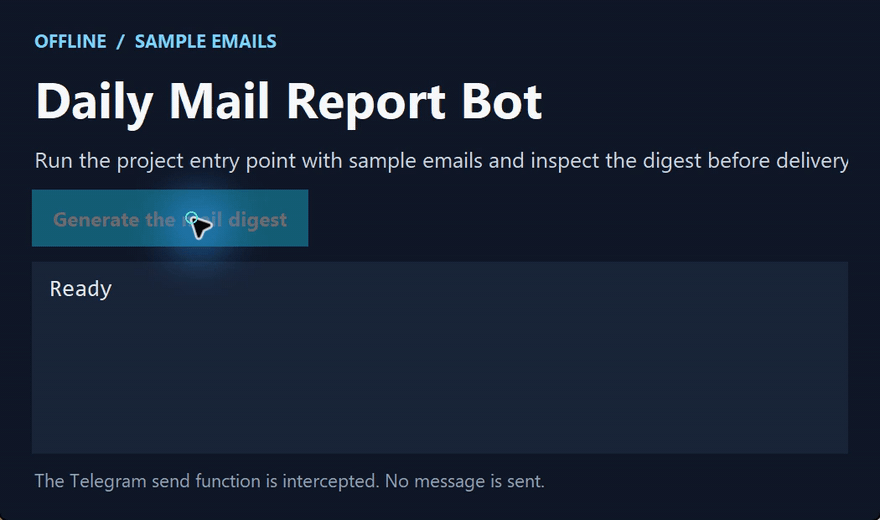

# Daily Mail Report Bot

**简体中文** · [English](https://github.com/chenbinghan666/mail_digest_bot/blob/main/docs/locales/README.en.md) · [日本語](https://github.com/chenbinghan666/mail_digest_bot/blob/main/docs/locales/README.ja.md) · [Deutsch](https://github.com/chenbinghan666/mail_digest_bot/blob/main/docs/locales/README.de.md) · [Français](https://github.com/chenbinghan666/mail_digest_bot/blob/main/docs/locales/README.fr.md) · [Español](https://github.com/chenbinghan666/mail_digest_bot/blob/main/docs/locales/README.es.md) · [Português](https://github.com/chenbinghan666/mail_digest_bot/blob/main/docs/locales/README.pt.md)

把示例邮件按发件人汇总，再通过 Telegram 发送每日报告。这是我的第一个公开 Python 练习项目，适合从报告生成与消息发送两个模块读起。

Python · Telegram Bot API

## 实操演示

用示例邮件运行主程序，查看生成的日报。发送步骤在本地拦截。

[](docs/images/project-demo.mp4)

[下载 MP4](docs/images/project-demo.mp4?raw=true)

## 功能

- 从 `.env` 读取本地配置。
- 统计示例邮件总数和各发件人的邮件数。
- 将报告发送到指定的 Telegram 聊天。

## 安装与运行

1. 运行 `python -m pip install -r requirements.txt` 安装依赖。
2. 将 `.env.example` 复制为 `.env`，填写以下配置。

   ```dotenv
   BOT_NAME=daily_mail_report_bot
   TELEGRAM_BOT_TOKEN=your_telegram_bot_token
   TELEGRAM_CHAT_ID=your_telegram_chat_id
   ```

3. 运行 `python main.py` 生成并发送报告。

请把包含 Bot Token 的 `.env` 留在本机。

## 报告示例

```text
Yesterday Mail Report

Total emails: 3

Top senders:
boss@example.com - 2 emails
client@example.com - 1 emails
```

## 代码入口

- `main.py` 串起整个流程。
- `config.py` 加载配置。
- `report_builder.py` 生成报告。
- `telegram_client.py` 发送报告。

当前版本使用示例数据。后续探索方向包括 Microsoft Graph 邮件读取、定时发送和邮件重要性判断。
