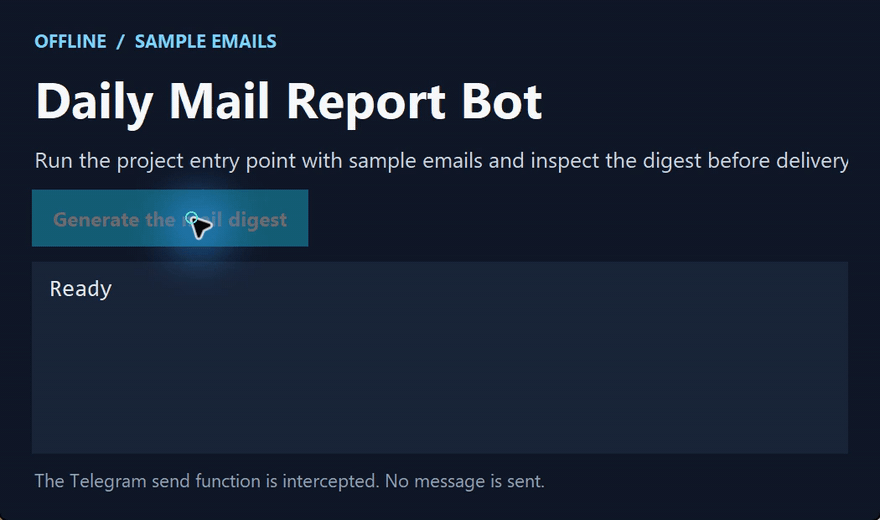

# Daily Mail Report Bot

[简体中文](https://github.com/chenbinghan666/mail_digest_bot/blob/main/README.md) · [English](https://github.com/chenbinghan666/mail_digest_bot/blob/main/docs/locales/README.en.md) · [日本語](https://github.com/chenbinghan666/mail_digest_bot/blob/main/docs/locales/README.ja.md) · [Deutsch](https://github.com/chenbinghan666/mail_digest_bot/blob/main/docs/locales/README.de.md) · [Français](https://github.com/chenbinghan666/mail_digest_bot/blob/main/docs/locales/README.fr.md) · **Español** · [Português](https://github.com/chenbinghan666/mail_digest_bot/blob/main/docs/locales/README.pt.md)

Agrupa correos de ejemplo por remitente y envía un informe diario a Telegram. Mi primer proyecto público en Python separa la generación del informe del envío de mensajes.

Python · Telegram Bot API

## Demostración

Genera un informe con correos de ejemplo. El envío a Telegram se intercepta de forma local.

[](../../docs/images/project-demo.mp4)

[Descargar MP4](../../docs/images/project-demo.mp4?raw=true)

## Función

- Lea la configuración local de `.env`.
- Cuente la cantidad total de correos electrónicos de muestra y la cantidad de correos electrónicos de cada remitente.
- Envíe el informe al chat de Telegram especificado.

## Instalar y ejecutar

1. Ejecute `python -m pip install -r requirements.txt` para instalar dependencias.
2. Copie `.env.example` a `.env` y complete la siguiente configuración.

   ```dotenv
   BOT_NAME=daily_mail_report_bot
   TELEGRAM_BOT_TOKEN=your_telegram_bot_token
   TELEGRAM_CHAT_ID=your_telegram_chat_id
   ```

3. Ejecute `python main.py` para generar y enviar el informe.

Mantenga `.env` que contenga Bot Token en esta máquina.

## Ejemplo de informe

```text
Yesterday Mail Report

Total emails: 3

Top senders:
boss@example.com - 2 emails
client@example.com - 1 emails
```

## Entrada de código

- `main.py` une todo el proceso.
- `config.py` carga la configuración.
- `report_builder.py` genera informes.
- `telegram_client.py` envía informe.

La versión actual utiliza datos de muestra. Las direcciones de exploración de seguimiento incluyen la lectura de correo electrónico de Microsoft Graph, el envío programado y el juicio de importancia del correo electrónico.
