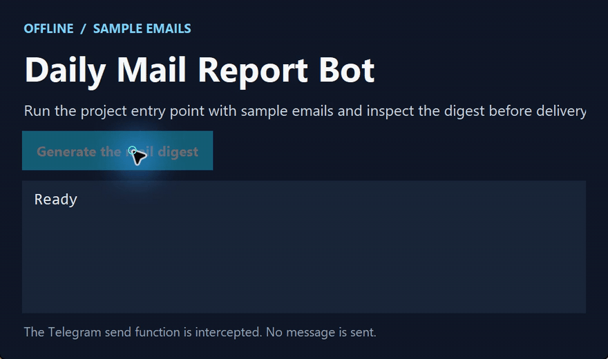

# Daily Mail Report Bot

[简体中文](https://github.com/chenbinghan666/mail_digest_bot/blob/main/README.md) · [English](https://github.com/chenbinghan666/mail_digest_bot/blob/main/docs/locales/README.en.md) · [日本語](https://github.com/chenbinghan666/mail_digest_bot/blob/main/docs/locales/README.ja.md) · [Deutsch](https://github.com/chenbinghan666/mail_digest_bot/blob/main/docs/locales/README.de.md) · **Français** · [Español](https://github.com/chenbinghan666/mail_digest_bot/blob/main/docs/locales/README.es.md) · [Português](https://github.com/chenbinghan666/mail_digest_bot/blob/main/docs/locales/README.pt.md)

Regroupe des e-mails d’exemple par expéditeur et envoie un rapport quotidien sur Telegram. Mon premier projet Python public sépare la génération du rapport et l’envoi du message.

Python · Telegram Bot API

## Démonstration

Génère un rapport à partir d’e-mails d’exemple. L’envoi vers Telegram est intercepté localement.

[](../../docs/images/project-demo.mp4)

[Télécharger le MP4](../../docs/images/project-demo.mp4?raw=true)

## Fonction

- Lisez la configuration locale à partir de `.env`.
- Comptez le nombre total d’échantillons d’e-mails et le nombre d’e-mails de chaque expéditeur.
- Envoyez le rapport au chat Telegram spécifié.

## Installer et exécuter

1. Exécutez `python -m pip install -r requirements.txt` pour installer les dépendances.
2. Copiez `.env.example` vers `.env` et remplissez la configuration suivante.

   ```dotenv
   BOT_NAME=daily_mail_report_bot
   TELEGRAM_BOT_TOKEN=your_telegram_bot_token
   TELEGRAM_CHAT_ID=your_telegram_chat_id
   ```

3. Exécutez `python main.py` pour générer et envoyer le rapport.

Veuillez conserver `.env` contenant le jeton de robot sur cette machine.

## Exemple de rapport

```text
Yesterday Mail Report

Total emails: 3

Top senders:
boss@example.com - 2 emails
client@example.com - 1 emails
```

## Saisie du code

- `main.py` enchaîne l’ensemble du processus.
- `config.py` charge la configuration.
- `report_builder.py` génère des rapports.
- `telegram_client.py` envoie un rapport.

La version actuelle utilise des exemples de données. Les instructions d'exploration de suivi incluent la lecture des e-mails Microsoft Graph, l'envoi planifié et le jugement de l'importance des e-mails.
