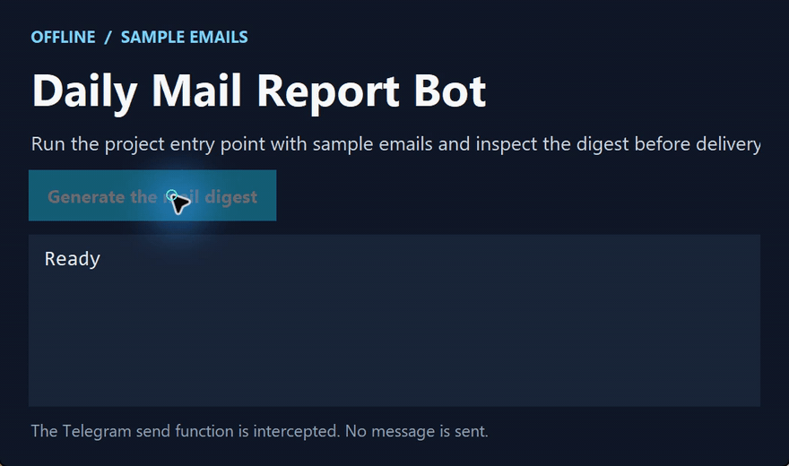

# Daily Mail Report Bot

[简体中文](https://github.com/chenbinghan666/mail_digest_bot/blob/main/README.md) · [English](https://github.com/chenbinghan666/mail_digest_bot/blob/main/docs/locales/README.en.md) · **日本語** · [Deutsch](https://github.com/chenbinghan666/mail_digest_bot/blob/main/docs/locales/README.de.md) · [Français](https://github.com/chenbinghan666/mail_digest_bot/blob/main/docs/locales/README.fr.md) · [Español](https://github.com/chenbinghan666/mail_digest_bot/blob/main/docs/locales/README.es.md) · [Português](https://github.com/chenbinghan666/mail_digest_bot/blob/main/docs/locales/README.pt.md)

サンプルメールを送信者ごとに集計し、日次レポートを Telegram に送ります。初めて公開した Python プロジェクトで、集計と送信をそれぞれ独立したモジュールで確認できます。

Python · Telegram Bot API

## 操作デモ

サンプルメールでメインプログラムを実行し、日報を確認します。Telegram への送信はローカルで止めています。

[](../../docs/images/project-demo.mp4)

[MP4 をダウンロード](../../docs/images/project-demo.mp4?raw=true)

## 機能

- `.env` からローカル構成を読み取ります。
- サンプルメールの総数と各送信者からのメールの数をカウントします。
- 指定された Telegram チャットにレポートを送信します。

## インストールして実行する

1. `python -m pip install -r requirements.txt` を実行して依存関係をインストールします。
2. `.env.example` を `.env` にコピーし、次の構成を入力します。

   ```dotenv
   BOT_NAME=daily_mail_report_bot
   TELEGRAM_BOT_TOKEN=your_telegram_bot_token
   TELEGRAM_CHAT_ID=your_telegram_chat_id
   ```

3. `python main.py` を実行してレポートを生成し、送信します。

Bot Token を含む `.env` をこのマシン上に保管してください。

## レポート例

```text
Yesterday Mail Report

Total emails: 3

Top senders:
boss@example.com - 2 emails
client@example.com - 1 emails
```

## コード入力

- `main.py` はプロセス全体をつなぎ合わせます。
- `config.py` は設定をロードします。
- `report_builder.py` はレポートを生成します。
- `telegram_client.py` がレポートを送信します。

現在のバージョンではサンプルデータを使用しています。フォローアップの探索指示には、Microsoft Graph の電子メールの読み取り、スケジュールされた送信、および電子メールの重要性の判断が含まれます。
